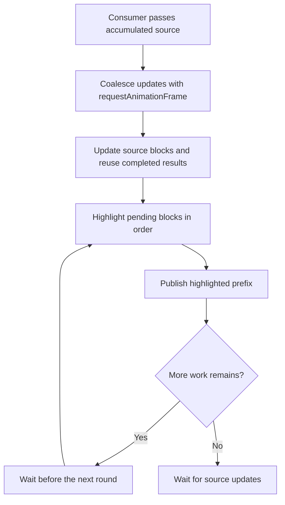

# Architecture

## Main flow

The consumer keeps the growing code string and passes the entire accumulated
source to `StreamCode` on each update. Keep its React key stable for one stream;
change the key to start a fresh session and cache.

```tsx
<StreamCode key={fileID} language="typescript">
  {code}
</StreamCode>
```

The implementation follows the [time-budgeting design](./time-budgeting.md):
highlight whole blocks in source order, check elapsed time between blocks, publish
results after each round, and pause when the budget is reached and work remains.
The same scheduler handles streaming updates and complete-file input.



## Shared initialization and prewarming

[`sharedHighlighterManager.ts`](../packages/react-code-stream/src/core/sharedHighlighterManager.ts)
owns one Shiki highlighter per loaded package module. It caches the initialization
promise, so simultaneous mounts share initialization. The highlighter starts with
no languages or themes; the manager loads requested resources and deduplicates
concurrent loads of the same language or theme. Successfully loaded resources stay
in Shiki. Failed initialization or resource loads can be retried.

`prewarmCodeStream({ languages, themes })` uses this same manager to load resources
before a view mounts. Without prewarming, `StreamCode` requests its language and
theme during initialization. See the [README example](../README.md#prewarming-optional).

Each component receives a lightweight tokenizer wrapper bound to its theme.
Sharing the highlighter does not share stream state: every mounted session owns
its scheduler, source blocks, highlighted results, and outgoing grammar states.
The manager configures the [JavaScript regex engine](./tokenizer.md#javascript-regex-engine).

## Block caching and scheduling

`StreamCode` fixes block size at ten newline-terminated lines. An unfinished final
block is highlighted too; ten lines is a caching boundary, not a display threshold.
On append-only updates, completed blocks retain their results and object identity.
A growing tail is highlighted again using the preceding completed block's grammar
state. Earlier edits or deletions reset the cache and rebuild in timed rounds.

The component fixes the processing target at 8 ms and the requested pause at
8 ms between unfinished rounds. These are internal settings, not public props. A synchronous Shiki call
must finish before the clock is checked, so one block can exceed the target.
These values do not bound initialization, React rendering, layout, or painting.
Only one continuation timer is pending; new source updates do not restart it.

See [time-budgeting.md](./time-budgeting.md) for cursor movement, timer reuse,
source replacement, and reset/disposal behavior.

## Rendering and cleanup

The component publishes only the highlighted prefix; pending source has no
separate plain-text preview. It extracts each block's inner code markup and renders
memoized block spans inside one shared `pre`/`code` container. Reused completed
blocks skip rendering. The view starts empty and clears on highlighting failure,
which is reported through `onError`.

Changing language or theme remounts the session. Cleanup
cancels its animation frame and disposes its scheduler, including pending timers.
Late initialization results cannot attach to an inactive session. Component
unmounting does not dispose the shared highlighter, which remains cached for the
module lifetime. Independently created tokenizers have separate ownership; their
callers must dispose them when a disposal method is provided.
