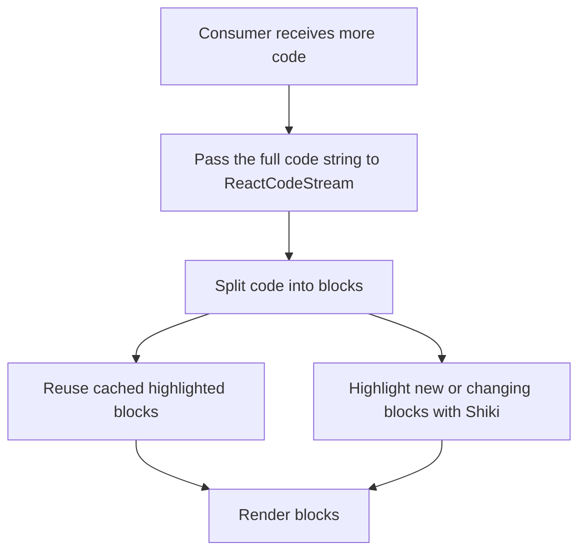
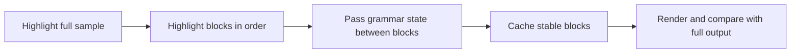

# Architecture

## What we are building

This is a learning project for building a React package and exploring how code highlighting can work while AI output is arriving.

The consumer keeps the growing code string and passes it to the component. The package uses Shiki to highlight code, caches it in blocks, and aims to keep already highlighted blocks unchanged when more text arrives.

```tsx
<ReactCodeStream key={fileID} language="typescript">
  {code}
</ReactCodeStream>
```

The same `key` means the same code stream. A new `key` starts a fresh stream and cache.

## Main flow



## Block caching

The code is divided into blocks, such as groups of lines. Each block keeps its source and highlighted result. When the stream grows, the package checks which blocks are still the same and reuses their results. The changing trailing block is highlighted again.

Some syntax can continue across lines, such as a multi-line comment or string. Shiki has a feature called **grammar state** that represents syntax context at a point in the code. Shiki can use a saved grammar state when highlighting the next piece of code. We can explore saving this state at block boundaries so each block is highlighted with the context that came before it.

This is something to test, not assume: first compare highlighting blocks with saved grammar state against highlighting the whole code at once. If the results match for our examples, use that approach in the cache. If they do not, adjust the block strategy.

## Rendering

Render blocks as separate React elements with stable keys. When a block is reused, keep its existing element; create new output for blocks that changed. Start with ordinary React rendering. We can explore `requestAnimationFrame` or direct DOM updates later if the playground shows a real performance problem.

## Learning steps

1. Use Shiki to highlight a complete code sample.
2. Split a sample into blocks and highlight them in order.
3. Try passing Shiki grammar state from one block to the next.
4. Cache earlier block results while the final block grows.
5. Compare cached output with highlighting the full sample at once.
6. Render the blocks in React and observe which parts update.


