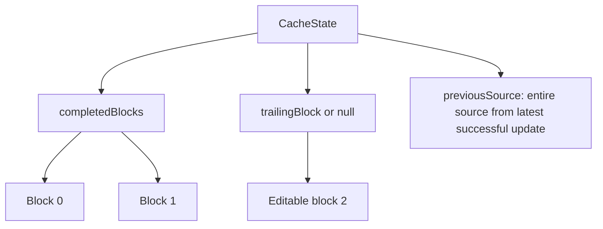
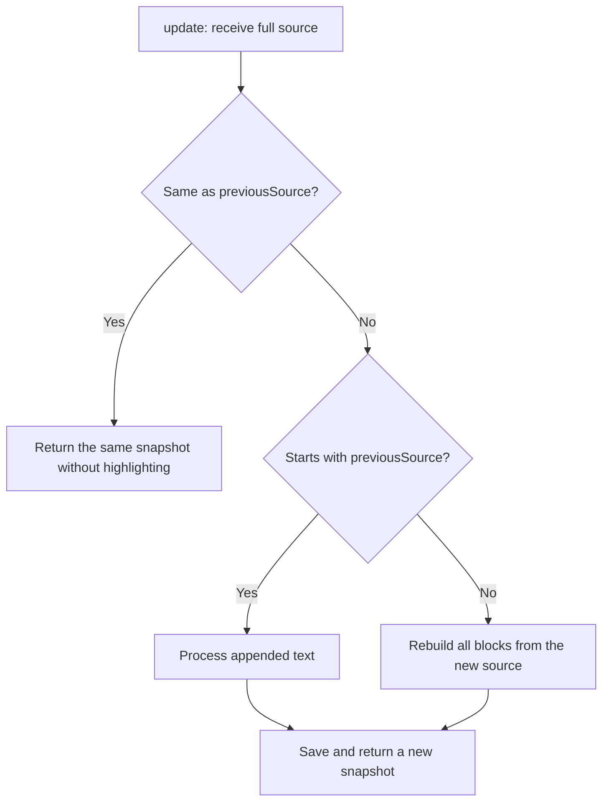
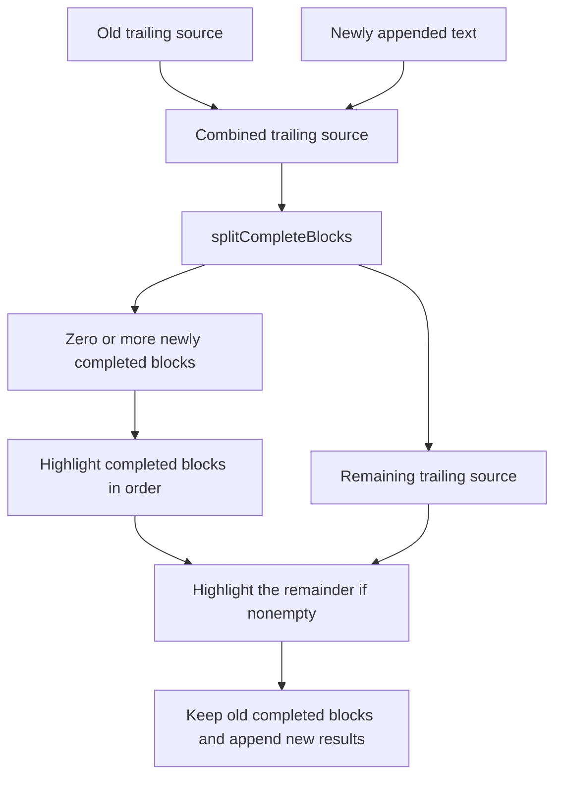
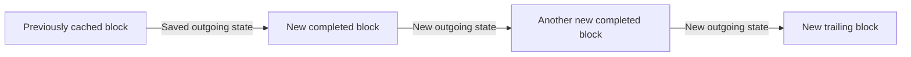

# How the block cache works

The cache splits streaming source into completed blocks and one editable trailing
block. When more text arrives, completed blocks keep their highlighted HTML. Only
the trailing source and any newly completed blocks need highlighting.

The implementation is in
[`incremental.ts`](../packages/react-code-stream/src/core/incremental.ts).
It uses the grammar-state tokenizer described in [tokenizer.md](./tokenizer.md).

## Creating a cache

Initialize the Shiki tokenizer first, then pass it to the synchronous cache factory:

```ts
const tokenizer = await createGrammarStateCodeTokenizer();
const cache = createIncrementalTokenizer({
  tokenizer,
  language: 'typescript',
  linesPerBlock: 10,
});

const snapshot = cache.update('const answer = 42;\n');
cache.reset();
```

`update(source)` accepts **all source received so far**, not just the latest chunk.
For example, successive calls might receive `"con"`, `"const"`, and then
`"const answer"`.

Each cache instance belongs to one stream with fixed settings. Create a new
instance when the stream, language, theme, tokenizer, or block size changes.
`linesPerBlock` defaults to 10 and must be a positive safe integer.

## What is stored



Each `CachedBlock` contains:

| Field | Meaning |
| --- | --- |
| `id` | Stable block identity for rendering. |
| `source` | Only this block's source, including its newline characters. |
| `html` | This block's highlighted HTML, with its own `pre` and `code` elements. |
| `outgoingGrammarState` | Context to use when highlighting the next block. It can be `undefined`, such as for plain text. |

`CacheState` contains:

| Field | Meaning |
| --- | --- |
| `completedBlocks` | Completed blocks in source order. These objects are reused during appends. |
| `trailingBlock` | The remainder that has not filled a complete block, or `null` if there is no remainder. |
| `previousSource` | The entire source from the latest successful update, used to detect appends and edits. |

For a 10-line block size, a snapshot could look like this:

```text
completedBlocks[0].source → lines 1–10
completedBlocks[1].source → lines 11–20
trailingBlock.source      → lines 21–24, with line 24 still growing
previousSource           → all source from line 1 through the current end
```

Treat returned snapshots as read-only. Grammar-state objects stay in memory;
displaying their fields as JSON is useful for inspection, but is not a way to
serialize and restore the full state.

## Choosing the update path



Equality checks the actual source, not just its length. Replacing one character
with another can keep the length unchanged while requiring a rebuild.

## Processing an append

First, extract only the new text:

```ts
const appendedText = source.slice(state.previousSource.length);
```

Combine it with the old trailing block's source. Previously completed source is
excluded from this highlighting work.



The splitter counts `\n` characters and cuts after every `linesPerBlock` complete
lines. It slices the original string, preserving both LF and CRLF newlines.
A standalone `\r` does not complete a line.

The final line must have a newline before it counts toward a completed block.
For example, with two lines per block:

```text
Source: "first\nsecond"
  completedBlocks: []
  trailingBlock:   "first\nsecond"

Source: "first\nsecond\nthird"
  completedBlocks: ["first\nsecond\n"]
  trailingBlock:   "third"
```

One update can create several completed blocks. Each stays a separate cache
entry, and the remaining source becomes the new trailing block. If the source
ends exactly at a block boundary, `trailingBlock` is `null`.

## Passing grammar state forward

Begin with the state from the last previously completed block, or `undefined`
when no completed block exists. Every newly highlighted block provides the state
for its successor.



When the trailing block grows without completing, highlight its entire source
again from the **previous completed block's state**. Do not use the old trailing
block's outgoing state: that state describes the end of the old source, while
this call starts again at its beginning.

A block may end inside a multiline comment or string. The grammar state carries
that context into the next block; completion depends on line count, not whether
all syntax constructs are closed.

## Block identity and snapshot reuse

The trailing block keeps its ID as it grows and when it becomes complete.
Additional blocks receive new IDs:

```text
Before append:
  completed #0 | trailing #1

After an append fills two more blocks:
  completed #0 | completed #1 | completed #2 | trailing #3
  reused        old tail promoted              new tail
```

During appends, existing completed block objects are reused. Their array is also
reused when no new completed blocks are added. Otherwise, a new array contains
the old objects followed by the newly completed blocks. Earlier snapshots are
not modified by the engine.

## Edits, deletions, and reset

If the new source does not start with `previousSource`, `rebuild(source)` replaces
the cache. It splits the entire new source and highlights all blocks sequentially,
starting without an incoming grammar state. Rebuilding assigns fresh IDs from
the existing counter. This version does not reuse unaffected blocks after edits.

Deleting everything rebuilds to an empty snapshot. Calling `reset()` explicitly
clears all blocks, previous source, grammar states, and the ID counter. The next
block starts at ID 0.

New snapshots and the ID counter are committed only after highlighting succeeds.
If highlighting throws, the previous cache remains available for a retry.

## Highlighting reuse and React rendering

These are two separate kinds of work:

| Mechanism | Work avoided |
| --- | --- |
| Cache engine | Running Shiki again for completed blocks during appends. |
| Stable React keys and memoized block components | Rendering completed block components again when their props stay unchanged. |

The [incremental demo](../apps/docs/src/components/incremental/index.tsx) uses
stable block IDs and a memoized component. Its parent still renders as snapshots
change, but completed block objects retain their identity so their components can
skip rendering. Each block's HTML is rendered separately.

The demo sends a freshly chosen random 5–15 character chunk every tick and passes
the accumulated source into `update()`. Its clear button stops the stream, calls
`reset()`, and clears the displayed snapshot.

When streaming finishes, a remainder smaller than a complete block stays in
`trailingBlock`. The engine currently has no separate finalize operation.
