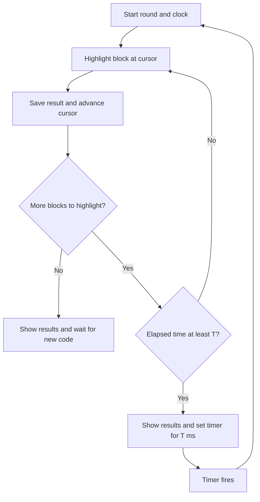
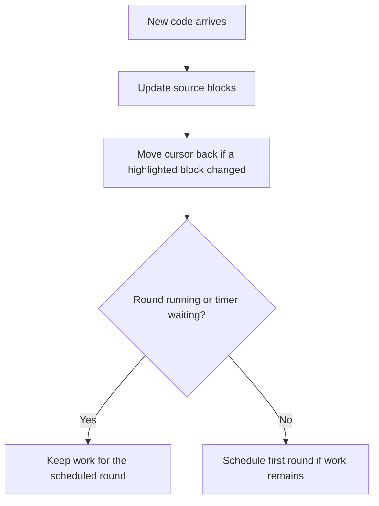

# Block Highlighting with a Time Budget

This is the proposed design, not an implemented feature yet. It builds on our
[tokenizer](./tokenizer.md) and [block cache](./block-cache.md).

The idea is: **highlight blocks in order, check elapsed time after each block,
and pause only when the budget is reached and more work remains.** Small streaming
updates and full code input use the same flow; no `streaming` prop selects a
different algorithm.

## Starting settings

| Setting | Starting value | Meaning |
| --- | --- | --- |
| `linesPerBlock` | 10 | Number of complete lines in a cached block; configurable. |
| `sliceBudgetMs` | 8 ms | Work budget for one processing round, called T below. |
| `continuationDelayMs` | 8 ms | Requested pause before continuing unfinished work. |

These are starting values to measure and tune, not measured performance guarantees.
Keep the work budget and pause duration independent of the block size. A larger
block can take longer to highlight, but increasing its time budget would also
allow longer periods of blocking the browser.

## Split code into blocks

One complete block contains 10 lines, each ending with a newline. Keep remaining
text in one unfinished block. We highlight that block too, but highlight it again
whenever it grows. Even the tenth line needs its newline to complete the block.
Preserve the original newline characters when splitting.

```text
Block 0: lines  1–10   complete
Block 1: lines 11–20   complete
Block 2: lines 21–24   unfinished; more text may arrive here
```

## Remember where to continue

Keep a cursor called `nextBlockIndex`. It points to the first block that needs
highlighting. Block numbers start at zero.

```text
Block:   0        1        2        3        4
         green    green    green    yellow   yellow
                                   ^
                         nextBlockIndex = 3
```

For each highlighted block, save its source, highlighted HTML, and outgoing
**grammar state**. Grammar state is context for the next block: for example,
“we are still inside a multiline comment.” Process blocks in order and pass that
context forward.

Keep the latest received source separately from highlighting progress. Receiving
block 4 does not mean we have highlighted block 4.

## Check the budget after each block

A **round** is one run of the processing loop. It ends when we catch up or when
we reach the budget with work still pending. For example, let `T = 8 ms`:

1. Start a clock at the beginning of a processing round.
2. Highlight the block at the cursor, including generating its HTML.
3. Save the result and move the cursor forward.
4. Check elapsed time since the round started.
5. If more work remains and elapsed time is below T, process another block.
6. If more work remains and elapsed time is at least T, continue after a T-ms timer.
7. Show the results from this round. If no work remains, wait for new code.

**There is no fixed “work T ms, wait T ms” cycle.** If a round finishes all work
in 2 ms, it returns immediately without a forced pause. The next arriving chunk
can schedule a new round, starting again at zero.

Each continuation also starts a fresh clock; only the cursor carries forward.
Waiting time and previous rounds do not consume the new round's budget. Use
`performance.now()` to measure processing time from the round's start.



When idle, schedule the first round with a zero-delay timer. After a budget pause,
use the T-ms timer. Both run the same processing function, regardless of input size.

Internally, `sliceBudgetMs` means how long we work and `continuationDelayMs` means
how long we pause. Initially both equal T. A “slice” simply means one round.
“Time budgeting” describes the work limit; “time slicing” describes dividing
unfinished work across these rounds. They are parts of the same approach.

We highlight each supplied block fully before checking the clock. We cannot pause
halfway through a Shiki call. The unfinished source block is allowed to contain
fewer than 10 lines, but its entire call must finish too.

## New code arrives while we wait

```text
Old tail: 8 lines + new text: 24 lines = 32 lines
Split: [B0: 10 lines] [B1: 10 lines] [B2: 10 lines] [B3: 2 lines]
T = 8 ms; pause = 8 ms

Round 1: B0 takes 4 ms + B1 takes 5 ms = 9 ms.
         Show B0 and B1. Cursor = 2. Set a timer for 8 ms.

Waiting: More text arrives and extends the pending source.
         Keep the same timer; do not start a second processing loop.

Round 2: Timer fires. Start a fresh clock at zero.
         Highlight B2 using B1's saved grammar state.
         If below budget, continue with B3, including text added while waiting.
         If caught up, show results and stop without a forced pause.
```

If B2 alone exhausts the second round's budget and B3 still needs work, show B2
and schedule another round for B3. No partially executed block is rendered.

**Do not restart the timer whenever text arrives.** Otherwise, a continuous stream
could keep postponing highlighting. Keep at most one waiting timer.



The browser may receive network data while highlighting runs, but our chunk
handler runs on the same main thread and must wait until we return control.
During the pause it can update the pending source. The timer resumes processing
even if no new text arrives. If an update callback sends new source during a round,
queue that update until a safe point instead of changing the active block list.

## The unfinished block needs special care

A cursor can move backward if a highlighted unfinished block grows:

```text
Before:
  B0 highlighted | B1 highlighted | B2 highlighted, unfinished
  Cursor = 3: we are caught up.

After more text:
  B0 unchanged   | B1 unchanged   | B2 changed | B3 new
  Cursor = 2: B2 needs highlighting again.
```

Rehighlight B2 using **B1's saved grammar state**, not B2's old outgoing state.
B2's old outgoing state describes its end, but we are starting again at its
beginning. After B2, continue with B3.

Keep the block's ID as it grows and becomes complete, so React recognizes it as
the same block. Reuse unchanged completed blocks and their results.

Small chunks can therefore keep a smooth streaming flow: highlight the growing
tail, show it, and wait for more text. Once it has 10 complete lines, cache it and
start a new tail. **Ten lines is a caching boundary, not a display threshold.**

## What the user sees

Show newly highlighted results after each round, not after each processed block.
For this version, do not add a separate plain-text preview of pending source.
Keep the last published view until updated highlighted results are ready. For
append-only updates, newly received text appears when highlighted; the existing
highlighted tail can remain visible until its replacement is ready. Clear old
results when resetting or replacing the source.

This preserves highlighted streaming while processing keeps up. If work falls
behind, updates can appear in larger batches. Scheduling improves responsiveness,
but does not guarantee perfectly smooth streaming under sustained load.

When streaming ends, finish pending rounds, including the unfinished final block.
When caught up, stop scheduling timers until source changes.

The current synchronous `update()` returns fully processed results. This design
will need a callback or subscription to deliver results as rounds finish.
Receiving source and finishing its highlighting become separate events.

## Cleanup: reset versus dispose

**Reset means “clear this stream and start again.”** For example, the user clicks
Clear. Cancel the timer, clear source and saved results, and move the cursor to
zero. The scheduler can be used again.

**Dispose means “stop this scheduler permanently because we no longer need it.”**
For example, the user leaves the page and React removes the code component.
Cleanup should:

- Cancel the waiting timer with `clearTimeout`.
- Prevent future rounds and view updates from this scheduler.
- Remove registered update callbacks and release saved source and results.
- Release the Shiki tokenizer if this component created it for its own use.
  Leave a shared tokenizer alive if other components still use it.

Calling dispose twice should be harmless. Create a new scheduler if needed later.
For React, stop an effect's scheduler in that effect's cleanup function. This also
needs to work when development Strict Mode runs setup and cleanup more than once.

Keep a session number too. Increase it on reset or replacement. Each scheduled
callback remembers its session number. If it no longer matches, the callback
belongs to old work and must return without updating anything.

| Situation | Action |
| --- | --- |
| More text appended | Keep completed results; queue changed or new blocks. |
| Identical source received | Leave existing work and timer alone. |
| Earlier text edited or deleted | Cancel old work and rebuild from block zero with the same timed rounds. |
| Language, theme, tokenizer, or block size changes | Replace the scheduler and start fresh. |
| Clear clicked | Reset. |
| Component removed | Dispose. |
| A block fails to highlight | Keep successful earlier blocks, report the error, and stop automatic retries. Leave the cursor at the failed block. |

Use `try/finally` to clear the “round is running” flag even on errors. Check the
session number again after notifying the view: its callback might reset or dispose
the scheduler. A callback error must not leave the scheduler stuck as running.

If Shiki finishes initializing after the component has already been removed,
do not start processing or update the view. Release that tokenizer if the removed
component owned it.

## Things to watch

- **T is a target, not a hard limit.** We check after a whole block, so one slow
  block can exceed T. Browser timers can also fire later than requested.
- **Pausing helps responsiveness.** Reusing completed results saves repeated work.
  The budget limits continuous work in one round, not total CPU use across many
  short rounds. Equal work and pause times do not guarantee a CPU percentage.
- **Keep the latest source, not a job for every arrival.** If an unfinished block
  changes several times during a pause, highlight its latest version.
- **Avoid scanning all old text on every append.** Split the old unfinished text
  plus new text. Keep complete source blocks, including those still pending.
- **Rendering costs time too.** HTML generation happens during the round; browser
  layout and painting happen later and need separate measurement.
- **Pending work can grow.** One large chunk, frequent small chunks, or expensive
  syntax can create a backlog. Keep pending source and process it in order without
  dropping text; display it when its highlighting is ready.

When implementing, check timer reuse, cursor movement, multiline comments across
blocks, cleanup, failures, and the final unfinished block. Measure representative
code and long lines before choosing T.

Reference: [Ace's background tokenizer](https://github.com/ajaxorg/ace/blob/master/src/background_tokenizer.js).
