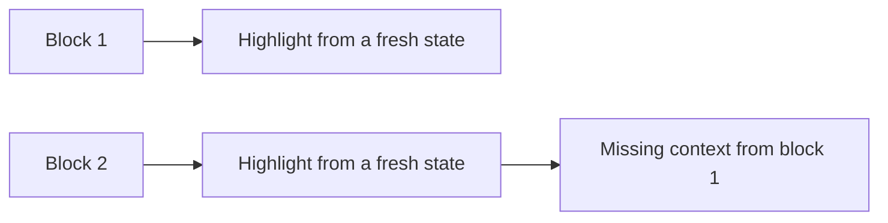
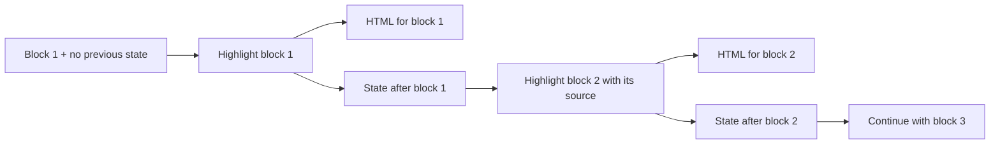
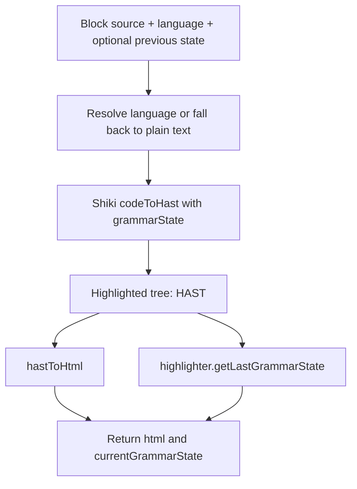
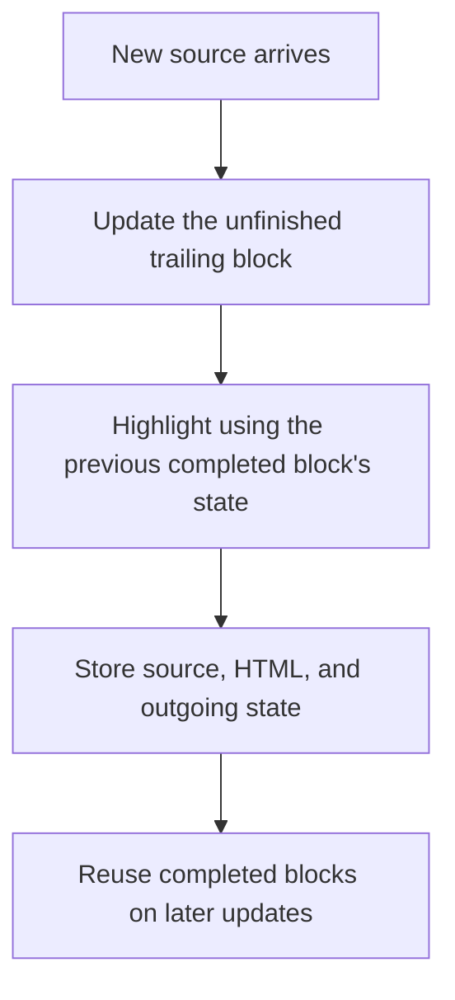

# How the tokenizer works

The tokenizer turns source code into highlighted HTML. Its implementation lives in
[`tokenizer.ts`](../packages/react-code-stream/src/core/tokenizer.ts).

For streaming code, the goal is to highlight new blocks while reusing the output
of completed blocks. To do that correctly, each block needs the grammar context
left by the previous block.

## The problem with highlighting blocks independently

Consider a comment that crosses a block boundary:

```text
Block 1                       Block 2
------------------------      ------------------------
const count = 2;              still inside the comment
/* a comment starts here      */
                              const label = "ready";
```

If block 2 is highlighted from a fresh state, the highlighter does not know that
block 1 opened a comment. It may treat `still inside the comment` as ordinary
code. Multiline strings can have the same problem.



Highlighting all accumulated source again would restore that context, but it
would also repeat work on completed blocks whenever more text arrives.

## Why we use Shiki

We use Shiki because it provides language grammars, themes, and an API for
continuing highlighting from a previous grammar state. It handles the language
rules, so this project can focus on splitting, caching, and rendering blocks.

A grammar state records the context at the end of a block, such as whether a
multiline comment is still open. Passing that state into the next block lets
Shiki continue with the context it needs.

Shiki does not inherently highlight without state. The problem arises when we
highlight separate blocks independently and discard their context. Its grammar
state API lets us preserve that context explicitly.



## The two tokenizer functions

| Function | Purpose | Returns |
| --- | --- | --- |
| `createCodeTokenizer` | Highlight a complete source string from a fresh state. | HTML |
| `createGrammarStateCodeTokenizer` | Highlight a block with optional context from the previous block. | HTML and the outgoing grammar state |

Both functions initialize Shiki asynchronously and preload the configured
languages and theme. After initialization, their `highlight` methods are
synchronous. Reuse the tokenizer instance across updates.

The default theme is `github-dark`. If a requested language is not loaded, the
tokenizer falls back to plain text.

## Highlighting a block in one pass

`createGrammarStateCodeTokenizer` accepts the block's source, its language, and
an optional `lastGrammarState`. Omit the state for the first block.



HAST is a tree representation of HTML. Shiki tokenizes the source and builds
this highlighted tree once. We then serialize the tree into an HTML string and
retrieve the grammar state associated with that same tree.

Previously, calling `codeToHtml` and `codeToTokens` separately tokenized the same
block twice. Using `codeToHast` removes that duplicate tokenization. HTML
serialization is still required; the actual speed improvement depends on the
source and should be measured.

```ts
const tokenizer = await createGrammarStateCodeTokenizer();

const first = tokenizer.highlight('/* comment begins', 'typescript');
const second = tokenizer.highlight(
  'comment ends */\nconst count = 2;',
  'typescript',
  first.currentGrammarState,
);

// first.html and second.html can be rendered as separate blocks.
// second.currentGrammarState is the input state for the next block.
```

`currentGrammarState` can be `undefined`, including for plain-text output. Treat
the state as an opaque object: keep it for continuation rather than trying to
reconstruct it from its displayed JSON fields.

## How this supports block caching

The tokenizer provides the pieces needed by a cache. It does not store or
invalidate cached blocks itself.



Follow these rules when adding the cache:

- Split blocks at complete line boundaries. An arbitrary character boundary can
  cut through a token; a grammar state is not a general cursor for resuming in
  the middle of a line.
- Keep the unfinished trailing block editable. When it grows, highlight it again
  using the state from the previous completed block, not its own previous result.
- Reuse states within the same tokenizer instance, language, and theme. Reset
  the cache when those settings change.
- If an earlier block changes, recompute it and the dependent blocks after it.
- Render each block's HTML separately: every result includes its own `pre` and
  `code` elements.

The docs demo uses 10 lines per block as an initial experiment. The final block
size should be chosen by measuring representative code, since line lengths vary.

